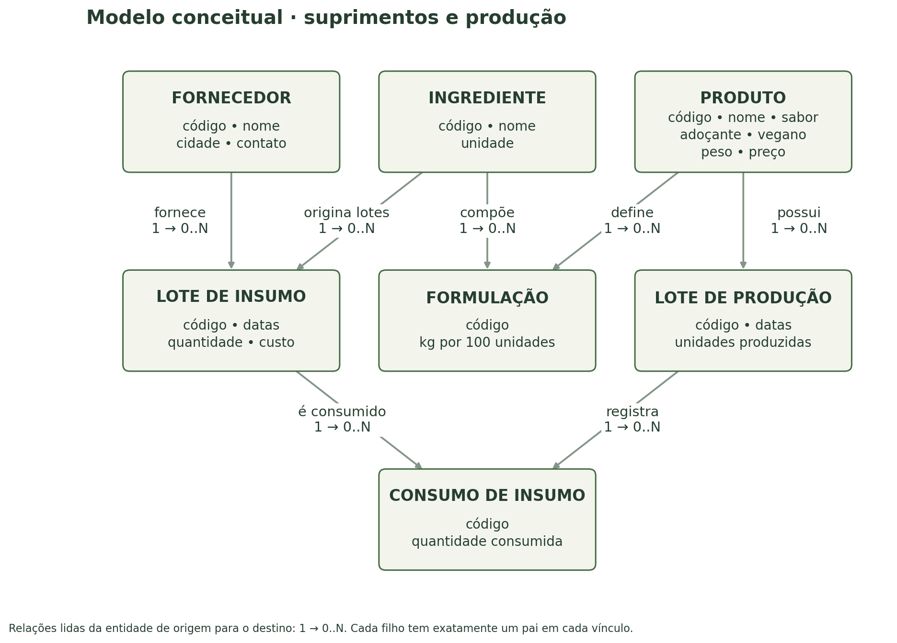
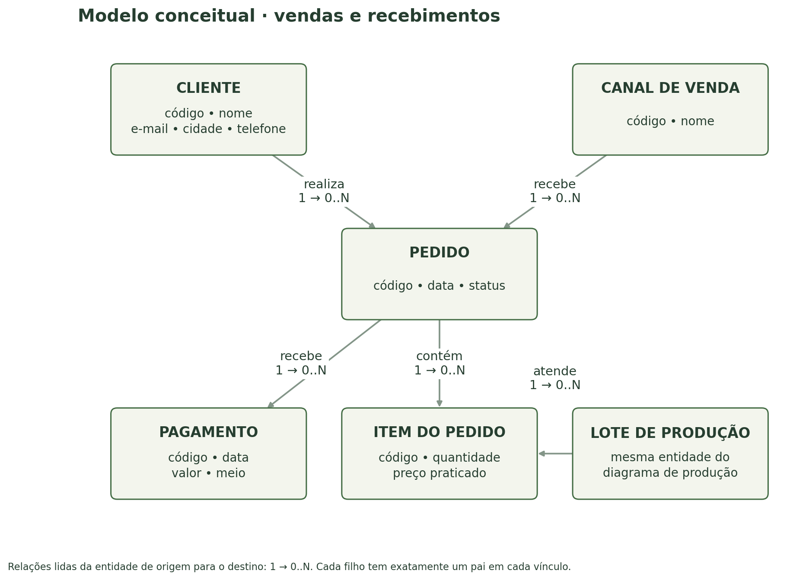
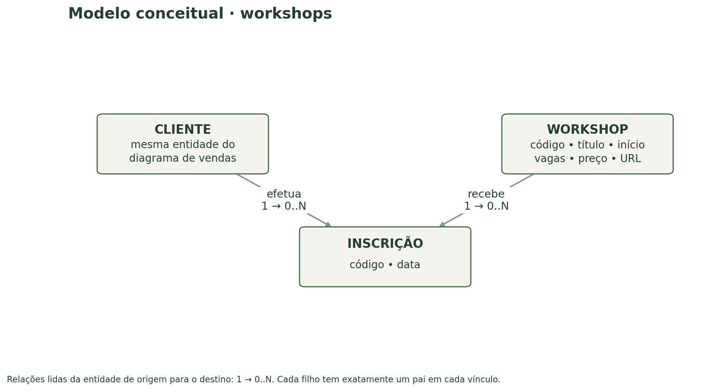
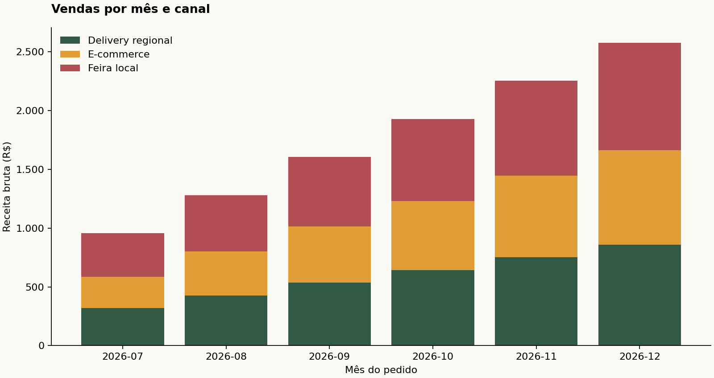
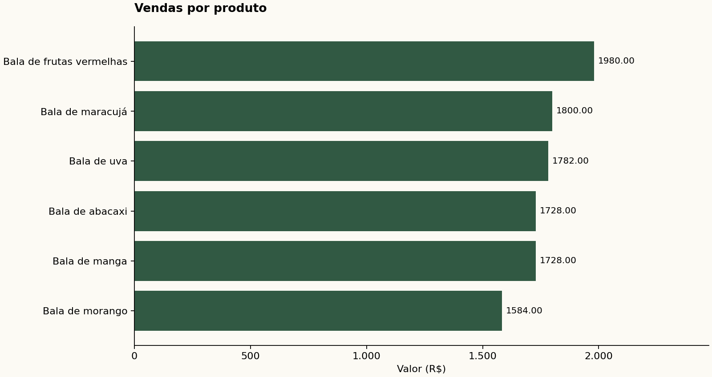
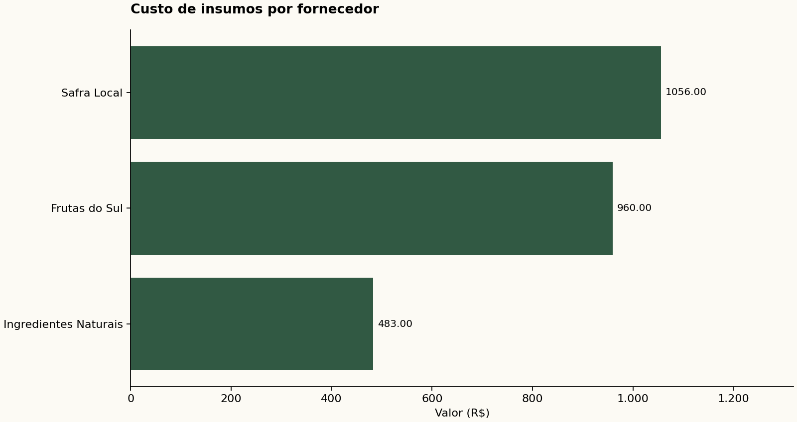

UNIVERSIDADE FEDERAL DE SANTA CATARINA
Campus Araranguá

Projeto de banco de dados relacional e aplicação de apoio à gestão

Integrantes: Breno Felisbino dos Anjos e Davi Ferreira da Silveira

Disciplina: Banco de Dados - DEC7588 - 2026.2

Professor: Alexandre Leopoldo Gonçalves

Araranguá, 21 de setembro de 2026

Proposta acadêmica baseada no dossiê fornecido. Registros, preços, formulações e validades de demonstração são fictícios. A autoria deve ser conferida antes da entrega; adicionar segundo integrante se houver.

Organização: as seções 1 a 6 atendem aos seis itens do relatório exigido. Os apêndices descrevem a aplicação, a validação e as fontes. O código-fonte completo acompanha este documento no pacote compactado.

Base de escopo: DEC7588-Trabalho-Final.pdf e Dossiê 100% Fruta.PDF, ambos fornecidos pelo solicitante. O dossiê descreve uma plataforma proposta; este projeto não presume que ela já exista na empresa.

# 1. Objetivo geral do sistema

Desenvolver um sistema de banco de dados relacional para apoiar a gestão da 100% Fruta, microempresa de Araranguá dedicada à fabricação artesanal de balas de frutas e à oferta de workshops sobre alimentação. O sistema integrará os cadastros de fornecedores, ingredientes, produtos e clientes aos registros de recebimento de insumos, formulações, produção por lote, consumo de matérias-primas, pedidos, pagamentos e inscrições. A solução permitirá rastrear a origem dos insumos utilizados nos lotes vendidos, consultar validades e disponibilidades e apoiar a seleção dos lotes pela ordem de entrada, reduzindo a dispersão de informações operacionais. Além disso, oferecerá consultas agregadas com visualização gráfica das vendas e dos custos de insumos, bem como uma integração com um modelo de linguagem para auxiliar a interpretação desses resultados, mantendo as decisões e a conferência dos dados sob responsabilidade do usuário.

## Delimitação da proposta

O projeto é um protótipo acadêmico administrativo com interface de terminal, PostgreSQL e Python. O tema foi adaptado ao dossiê da empresa. Não é um e-commerce público nem um sistema já homologado para operação comercial. O escopo privilegia os conceitos de modelagem, integridade relacional, manipulação de dados, agregação e integração com IA exigidos pela disciplina.

## Entregas que acompanham o relatório

| Artefato | Conteúdo |
|---|---|
| Aplicação | Menu, CRUD em 14 tabelas, relatórios, consulta PEPS, criação/carga/remoção e integração Ollama. |
| Banco de dados | DDL completo, dados sintéticos, índices, views e gatilhos de validação. |
| Resultados | Três consultas com amostras, gráficos, CSV e páginas HTML independentes. |
| Apoio à apresentação | Instruções de instalação, testes, roteiro, checklist e indicação de temática. |

# 2. Descrição detalhada e requisitos

## 2.1 Contexto, atores e informações de origem

O dossiê caracteriza a 100% Fruta como uma microempresa de Araranguá, Santa Catarina, especializada em balas artesanais de frutas. O portfólio citado inclui morango, manga, maracujá, uva, abacaxi e frutas vermelhas, com mel, açúcar demerara ou xilitol como alternativas de adoçante. Também são mencionadas opções veganas, pectina e workshops online. Esses elementos orientam os cadastros propostos, sem converter as afirmações comerciais do material em comprovação nutricional ou sanitária.

A operação descrita enfrenta perecibilidade e dependência de fornecedores sazonais. O dossiê propõe controle por PEPS, rastreabilidade de lotes e validades, vendas em e-commerce, delivery regional e feiras. A aplicação oferece uma visão administrativa desses processos. O ator principal é o responsável pela gestão; produção e vendas utilizam o mesmo menu no protótipo. Não há autenticação ou separação de permissões nesta versão.

## 2.2 Suprimentos e produção

RF01 - Cadastrar fornecedores com nome, cidade e contato, e ingredientes identificados de forma única. A unidade de medida de insumos é quilograma, evitando conversões implícitas. Cada recebimento forma um lote de insumo vinculado a exatamente um fornecedor e a um ingrediente, com código único, data de recebimento, validade, quantidade e custo unitário. Um fornecedor e um ingrediente podem existir antes de qualquer recebimento.

RF02 - Cadastrar produtos com sabor, adoçante, indicação vegana, peso da embalagem e preço de referência. A formulação associa ingredientes ao produto e registra a quantidade de referência por 100 unidades. A fórmula não substitui o apontamento real: cada lote de produção identifica o produto, código, data, validade e quantidade de embalagens produzidas, e os consumos relacionam os lotes de insumos efetivamente utilizados àquele lote produzido.

RF03 - Calcular o saldo de cada lote de insumo como quantidade recebida menos consumos. Calcular o saldo disponível do produto como quantidade produzida menos unidades alocadas aos pedidos. Pedidos não enviados também comprometem esse saldo; por isso ele não equivale ao estoque físico em prateleira. O programa lista lotes positivos e válidos na data informada, ordenados por entrada ou produção, com desempate pelo ID. O operador escolhe o lote e registra o consumo ou item; a divisão entre lotes é explícita.

## 2.3 Comercial e educação

RF04 - Manter clientes e canais de venda separados dos pedidos. Cada pedido pertence a um cliente e canal, informa data e status e pode receber vários itens. Cada item referencia um lote de produção e guarda quantidade e preço praticado. Dois lotes do mesmo produto podem aparecer em linhas diferentes; não se repete o mesmo lote em duas linhas do mesmo pedido. Um pedido recém-criado pode estar sem itens enquanto o cadastro é concluído.

RF05 - Registrar pagamentos associados a pedidos com data, meio e valor positivo. Um pedido pode ter zero ou vários pagamentos, permitindo lançamentos parciais. Não há conciliação automática nem bloqueio por total pago; os pagamentos não integram as consultas de receita para evitar duplicação ao unir duas relações 1:N. RF06 - Cadastrar workshops com data/hora, vagas, preço e URL, e inscrições que associam um cliente a uma edição, sem duplicidade e sem ultrapassar a capacidade.

## 2.4 Operações, análises e IA

RF07 - Disponibilizar inserção, consulta, atualização e exclusão em todas as 14 tabelas. A listagem é paginada; a consulta individual usa o ID. O programa mostra referências possíveis, valida campos obrigatórios e preserva chaves primárias. Erros de unicidade, chave estrangeira, tipo ou regra de negócio são informados sem confirmar alterações inválidas. Cadastros dependentes devem ser excluídos antes dos pais, pois as FKs usam restrição de exclusão.

RF08 - Oferecer três consultas parametrizadas por intervalo de datas: receita mensal por canal, unidades e receita por produto e consumo/custo de insumos por fornecedor. Cada consulta utiliza ao menos três tabelas, GROUP BY e funções de agregação. O programa imprime os resultados e gera uma tabela e um gráfico no mesmo HTML, além de CSV e PNG. O início é inclusivo e o fim exclusivo, facilitando cortes mensais sem depender do último dia do mês.

RF09 - Criar a estrutura e carregar dados predefinidos por uma única opção. As etapas são transacionais e uma base já preparada é recusada, evitando duplicação. Uma opção independente remove o schema exclusivo fruta, incluindo tabelas, views e funções, depois de confirmação literal. O banco de dados PostgreSQL deve existir antes da conexão da aplicação.

RF10 - Encaminhar resultados agregados das três consultas a um LLM local por meio da API do Ollama. O assistente deve produzir uma análise em português, ações possíveis e limitações, sem receber dados individuais de clientes ou executar comandos. Os valores enviados e a resposta são gravados para conferência. A indisponibilidade do serviço gera uma mensagem de erro, sem inventar uma análise.

## 2.5 Regras de integridade e requisitos não funcionais

RN01 - Quantidades e preços de venda devem ser positivos; custos e preços de workshops podem ser zero. RN02 - A validade não antecede o recebimento ou a produção. RN03 - O consumo é permitido somente quando o insumo está disponível e válido na data de produção; a venda exige lote produzido e válido na data do pedido. Gatilhos impedem exceder o saldo e recusam alterações retroativas de datas e quantidades que invalidariam operações já registradas.

RN04 - Cada inscrição é única por cliente/workshop e não pode ocorrer após a data do evento. A capacidade não pode ser reduzida abaixo das inscrições existentes. RN05 - O marcador vegano não pode coexistir com adoçante mel. Essa regra não verifica outros ingredientes e não equivale a certificação. RN06 - Os códigos de lotes, nomes de ingredientes, produtos, fornecedores e canais e e-mails de clientes são únicos, conforme as hipóteses simplificadoras deste projeto.

RNF01 - Utilizar PostgreSQL 16+ e Python 3.10+, com valores monetários NUMERIC no banco. RNF02 - Usar parâmetros SQL e identificadores controlados, sem concatenar texto informado pelo usuário a comandos. RNF03 - Organizar código, SQL e documentação para reprodução local. RNF04 - Gerar relatórios visualizáveis sem servidor web. A solução é destinada à demonstração monousuário; não foi dimensionada nem testada para carga produtiva.

## 2.6 Hipóteses e exclusões

O dossiê não fornece cadastros, formulações quantitativas, preços, custos, prazos de validade ou transações. Esses dados são exclusivamente didáticos, inclusive os meses futuros simulados. Não se implementam perdas, devoluções, auditoria, versionamento de receitas, FEFO, gateway, logística, campanhas, notas fiscais ou pagamentos de workshops. Consumos podem divergir da formulação de referência; o sistema registra a diferença, mas não certifica rendimento, composição ou segurança alimentar. A estatística de mercado mencionada no dossiê não é utilizada como evidência quantitativa neste projeto.

# 3. Modelagem conceitual

O modelo possui 14 entidades: dez entidades de cadastro ou evento e quatro entidades associativas (Formulação, Consumo de insumo, Item do pedido e Inscrição). Os diagramas apresentam o mesmo modelo em três recortes para preservar legibilidade. Cliente e Lote de produção aparecem repetidos apenas como pontos de conexão, sem representar entidades adicionais.

Cada ligação marcada 1 → 0..N indica que uma ocorrência da entidade de origem pode ter zero ou muitas ocorrências no destino, e cada ocorrência do destino se vincula a exatamente uma origem. A participação mínima zero permite cadastrar pais antes dos filhos. Formulação, Consumo, Item e Inscrição resolvem associações N:N com atributos próprios.



## Rastreabilidade

A partir de um item vendido, identifica-se o lote de produção; por seus consumos, chega-se aos lotes de insumos, ingredientes e fornecedores. Uma formulação descreve a referência para um produto, enquanto o consumo guarda a origem efetiva dos insumos usados em um lote específico. Não se confunde uma receita prevista com evidência de produção.

## 3.1 Comercial e recebimentos



Um pedido pode receber vários pagamentos sem multiplicar seus itens. A opção por status confirmado, enviado e entregue delimita que todos os pedidos existentes são compromissos comerciais; não se modelam carrinhos ou cancelamentos por status.

## 3.2 Educação e relacionamento



Cliente e Workshop se relacionam por Inscrição. A entidade associativa registra a data e permite impor unicidade e limite de vagas. A inscrição não gera automaticamente um pedido de produtos.

## 3.3 Entidades e significado dos atributos

| Entidade | Significado |
|---|---|
| cliente | Pessoa cadastrada para compras ou workshops; e-mail identifica o cadastro nesta proposta. |
| fornecedor | Origem comercial dos lotes de matérias-primas, com contato e cidade. |
| ingrediente | Insumo em unidade kg, independente do fornecedor e do lote recebido. |
| lote_insumo | Recebimento rastreável com quantidade, custo, datas e código próprios. |
| produto | Embalagem comercial de bala artesanal, sabor, adoçante, peso, preço de referência e marcador vegano. |
| formulacao | Quantidade de cada ingrediente prevista para 100 embalagens do produto. |
| lote_producao | Evento de produção de um produto, com quantidade e validade próprias. |
| consumo_insumo | Quantidade efetivamente retirada de um lote de insumo para um lote produzido. |
| canal_venda | Meio comercial de origem do pedido: e-commerce, delivery ou feira, entre outros. |
| pedido | Compromisso comercial de um cliente em um canal e uma data, com status. |
| item_pedido | Quantidade alocada de um lote produzido a um pedido, com preço unitário praticado. |
| pagamento | Lançamento de recebimento relacionado a um pedido, com valor, data e meio. |
| workshop | Edição de um evento educacional online, com capacidade, preço e endereço de acesso. |
| inscricao | Participação de um cliente em uma edição de workshop, com data de registro. |

Identificadores conceituais: todos os registros possuem um código interno. Código externo do lote, e-mail e nomes selecionados recebem unicidade adicional. Os atributos de ligação são materializados como chaves estrangeiras somente no modelo lógico.

# 4. Modelagem lógica

## 4.1 Transformação do conceitual para o relacional

Cada entidade origina uma tabela. Cada relação 1:N é transformada em uma chave estrangeira NOT NULL na tabela do lado N. As quatro entidades associativas recebem ID próprio e uma restrição UNIQUE no par de referências. Essa escolha preserva a unicidade de negócio e uniformiza o CRUD por ID. As chaves primárias são inteiros gerados por identidade; exclusões são restritas para proteger dependências.

A notação a seguir define as relações derivadas do modelo conceitual. PK identifica a chave primária; os campos com sufixo _id são FKs e têm seus destinos explicitados na tabela seguinte. Tipos, comprimentos, domínios, nulabilidade e restrições completas constam no DDL da seção 5.

| Relação | Atributos e chaves |
|---|---|
| cliente | id [PK], nome, email, cidade, telefone |
| fornecedor | id [PK], nome, cidade, contato |
| ingrediente | id [PK], nome, unidade |
| lote_insumo | id [PK], fornecedor_id [FK], ingrediente_id [FK], codigo, recebido_em, validade, quantidade_kg, custo_kg |
| produto | id [PK], nome, sabor, adocante, vegano, peso_g, preco_referencia |
| formulacao | id [PK], produto_id [FK], ingrediente_id [FK], kg_por_100_unidades |
| lote_producao | id [PK], produto_id [FK], codigo, produzido_em, validade, quantidade_unidades |
| consumo_insumo | id [PK], lote_producao_id [FK], lote_insumo_id [FK], quantidade_kg |
| canal_venda | id [PK], nome |
| pedido | id [PK], cliente_id [FK], canal_venda_id [FK], data_pedido, status |
| item_pedido | id [PK], pedido_id [FK], lote_producao_id [FK], quantidade, preco_unitario |
| pagamento | id [PK], pedido_id [FK], pago_em, valor, meio |
| workshop | id [PK], titulo, inicio, vagas, preco, url |
| inscricao | id [PK], cliente_id [FK], workshop_id [FK], inscrito_em |

## 4.2 Mapeamento das chaves estrangeiras

| Tabela de origem | Chave estrangeira | Referência |
|---|---|---|
| lote_insumo | fornecedor_id | fornecedor.id |
| lote_insumo | ingrediente_id | ingrediente.id |
| formulacao | produto_id | produto.id |
| formulacao | ingrediente_id | ingrediente.id |
| lote_producao | produto_id | produto.id |
| consumo_insumo | lote_producao_id | lote_producao.id |
| consumo_insumo | lote_insumo_id | lote_insumo.id |
| pedido | cliente_id | cliente.id |
| pedido | canal_venda_id | canal_venda.id |
| item_pedido | pedido_id | pedido.id |
| item_pedido | lote_producao_id | lote_producao.id |
| pagamento | pedido_id | pedido.id |
| inscricao | cliente_id | cliente.id |
| inscricao | workshop_id | workshop.id |

## 4.3 Chaves alternativas

São únicos: cliente.email; fornecedor.nome; ingrediente.nome; produto.nome; canal_venda.nome; lote_insumo.codigo; lote_producao.codigo. As associações são únicas por (produto_id, ingrediente_id), (lote_producao_id, lote_insumo_id), (pedido_id, lote_producao_id) e (cliente_id, workshop_id), respectivamente. Insumos, produtos e clientes distintos devem receber identificadores próprios, sem listas embutidas em campos.

## 4.4 Normalização e escolhas de armazenamento

Primeira forma normal: cada atributo contém um valor atômico e as repetições são representadas em tabelas associativas. Segunda forma normal: atributos de uma associação, como quantidade consumida, dependem do vínculo completo identificado pela chave alternativa, e não apenas de um dos participantes. Terceira forma normal: fornecedor, ingrediente, produto, cliente e canal são mantidos separadamente, evitando que seus dados descritivos se repitam em cada operação.

O preço de referência do produto é diferente do preço praticado em um item. O segundo depende da venda e deve ser armazenado para que alterações futuras no catálogo não modifiquem o valor das vendas registradas. De modo semelhante, o custo do lote de insumo pertence ao recebimento específico. Alterações administrativas nesses próprios registros são permitidas pelo CRUD e recalculam os relatórios; não há histórico de versões ou auditoria.

Receita do pedido, custo consumido e saldos não são colunas editáveis. São obtidos por agregação. As views saldo_insumo e saldo_produto sintetizam a disponibilidade por lote; a pré-agregação dos filhos evita multiplicação de linhas. As consultas gerenciais não juntam pagamentos e itens simultaneamente, pois duas relações 1:N poderiam duplicar valores e produzir somas incorretas.

## 4.5 Domínios, índices e limites

| Grupo | Definição |
|---|---|
| IDs | INTEGER por identidade, PK; FKs INTEGER. |
| Quantidades | Insumos em NUMERIC(12,3); unidades produzidas e vendidas em INTEGER. |
| Dinheiro | NUMERIC(12,2), evitando armazenamento monetário em ponto flutuante. |
| Datas | DATE nas operações por dia; TIMESTAMP local em workshop (horário assumido: Brasília). |
| Domínios | Status: confirmado/enviado/entregue. Adoçante: mel/demerara/xilitol. Pagamento: pix/cartao/dinheiro. |
| Índices | Ordem PEPS, data do pedido e referências usadas em soma de consumos, itens, pagamentos e inscrições. |

A integridade estrutural utiliza PK, FK, UNIQUE, NOT NULL e CHECK. Regras que consultam outras linhas utilizam funções e gatilhos; não são expressas por CHECK com subconsultas. Os gatilhos usam bloqueios de linha para coordenar alocações no mesmo lote, mas a validação executada foi sequencial e não comprova comportamento sob carga concorrente. A fonte Mermaid do modelo lógico está em docs/modelo_logico.mmd.

# 5. Script DDL

A transcrição abaixo é o script completo sql/01_schema.sql, incluindo tabelas, índices, views, funções e gatilhos. A aplicação o executa na mesma transação da carga inicial. O schema fruta deve estar ausente, e o banco PostgreSQL deve ter sido criado previamente. A documentação oficial consultada descreve as restrições utilizadas [3].

```sql
-- 100% Fruta | PostgreSQL 16+ | executar em uma transacao.
-- Schema exclusivo evita alterar tabelas de outros projetos.
CREATE SCHEMA fruta;
SET search_path TO fruta, public;

CREATE TABLE cliente (
 id integer GENERATED BY DEFAULT AS IDENTITY PRIMARY KEY,
 nome varchar(100) NOT NULL CHECK (btrim(nome) <> ''),
 email varchar(150) NOT NULL UNIQUE,
 cidade varchar(80) NOT NULL,
 telefone varchar(30)
);
CREATE TABLE fornecedor (
 id integer GENERATED BY DEFAULT AS IDENTITY PRIMARY KEY,
 nome varchar(100) NOT NULL UNIQUE,
 cidade varchar(80) NOT NULL,
 contato varchar(150) NOT NULL
);
CREATE TABLE ingrediente (
 id integer GENERATED BY DEFAULT AS IDENTITY PRIMARY KEY,
 nome varchar(80) NOT NULL UNIQUE,
 unidade varchar(4) NOT NULL DEFAULT 'kg' CHECK (unidade = 'kg')
);
CREATE TABLE lote_insumo (
 id integer GENERATED BY DEFAULT AS IDENTITY PRIMARY KEY,
 fornecedor_id integer NOT NULL REFERENCES fornecedor(id) ON DELETE RESTRICT,
 ingrediente_id integer NOT NULL REFERENCES ingrediente(id) ON DELETE RESTRICT,
 codigo varchar(40) NOT NULL UNIQUE,
 recebido_em date NOT NULL,
 validade date NOT NULL,
 quantidade_kg numeric(12,3) NOT NULL CHECK (quantidade_kg > 0),
 custo_kg numeric(12,2) NOT NULL CHECK (custo_kg >= 0),
 CHECK (validade >= recebido_em)
);
CREATE TABLE produto (
 id integer GENERATED BY DEFAULT AS IDENTITY PRIMARY KEY,
 nome varchar(100) NOT NULL UNIQUE,
 sabor varchar(60) NOT NULL,
 adocante varchar(20) NOT NULL CHECK (adocante IN ('mel','demerara','xilitol')),
 vegano boolean NOT NULL,
 peso_g integer NOT NULL CHECK (peso_g > 0),
 preco_referencia numeric(12,2) NOT NULL CHECK (preco_referencia > 0),
 CHECK (NOT (vegano AND adocante = 'mel'))
);
CREATE TABLE formulacao (
 id integer GENERATED BY DEFAULT AS IDENTITY PRIMARY KEY,
 produto_id integer NOT NULL REFERENCES produto(id) ON DELETE RESTRICT,
 ingrediente_id integer NOT NULL REFERENCES ingrediente(id) ON DELETE RESTRICT,
 kg_por_100_unidades numeric(12,3) NOT NULL CHECK (kg_por_100_unidades > 0),
 UNIQUE (produto_id, ingrediente_id)
);
CREATE TABLE lote_producao (
 id integer GENERATED BY DEFAULT AS IDENTITY PRIMARY KEY,
 produto_id integer NOT NULL REFERENCES produto(id) ON DELETE RESTRICT,
 codigo varchar(40) NOT NULL UNIQUE,
 produzido_em date NOT NULL,
 validade date NOT NULL,
 quantidade_unidades integer NOT NULL CHECK (quantidade_unidades > 0),
 CHECK (validade >= produzido_em)
);
CREATE TABLE consumo_insumo (
 id integer GENERATED BY DEFAULT AS IDENTITY PRIMARY KEY,
 lote_producao_id integer NOT NULL REFERENCES lote_producao(id) ON DELETE RESTRICT,
 lote_insumo_id integer NOT NULL REFERENCES lote_insumo(id) ON DELETE RESTRICT,
 quantidade_kg numeric(12,3) NOT NULL CHECK (quantidade_kg > 0),
 UNIQUE (lote_producao_id, lote_insumo_id)
);
CREATE TABLE canal_venda (
 id integer GENERATED BY DEFAULT AS IDENTITY PRIMARY KEY,
 nome varchar(50) NOT NULL UNIQUE
);
CREATE TABLE pedido (
 id integer GENERATED BY DEFAULT AS IDENTITY PRIMARY KEY,
 cliente_id integer NOT NULL REFERENCES cliente(id) ON DELETE RESTRICT,
 canal_venda_id integer NOT NULL REFERENCES canal_venda(id) ON DELETE RESTRICT,
 data_pedido date NOT NULL,
 status varchar(15) NOT NULL DEFAULT 'confirmado'
   CHECK (status IN ('confirmado','enviado','entregue'))
);
CREATE TABLE item_pedido (
 id integer GENERATED BY DEFAULT AS IDENTITY PRIMARY KEY,
 pedido_id integer NOT NULL REFERENCES pedido(id) ON DELETE RESTRICT,
 lote_producao_id integer NOT NULL REFERENCES lote_producao(id) ON DELETE RESTRICT,
 quantidade integer NOT NULL CHECK (quantidade > 0),
 preco_unitario numeric(12,2) NOT NULL CHECK (preco_unitario > 0),
 UNIQUE (pedido_id, lote_producao_id)
);
CREATE TABLE pagamento (
 id integer GENERATED BY DEFAULT AS IDENTITY PRIMARY KEY,
 pedido_id integer NOT NULL REFERENCES pedido(id) ON DELETE RESTRICT,
 pago_em date NOT NULL,
 valor numeric(12,2) NOT NULL CHECK (valor > 0),
 meio varchar(15) NOT NULL CHECK (meio IN ('pix','cartao','dinheiro'))
);
CREATE TABLE workshop (
 id integer GENERATED BY DEFAULT AS IDENTITY PRIMARY KEY,
 titulo varchar(120) NOT NULL,
 inicio timestamp NOT NULL,
 vagas integer NOT NULL CHECK (vagas > 0),
 preco numeric(12,2) NOT NULL CHECK (preco >= 0),
 url varchar(250)
);
CREATE TABLE inscricao (
 id integer GENERATED BY DEFAULT AS IDENTITY PRIMARY KEY,
 cliente_id integer NOT NULL REFERENCES cliente(id) ON DELETE RESTRICT,
 workshop_id integer NOT NULL REFERENCES workshop(id) ON DELETE RESTRICT,
 inscrito_em date NOT NULL,
 UNIQUE (cliente_id, workshop_id)
);

CREATE INDEX idx_lote_insumo_peps ON lote_insumo(ingrediente_id, recebido_em, id);
CREATE INDEX idx_lote_producao_peps ON lote_producao(produto_id, produzido_em, id);
CREATE INDEX idx_pedido_data ON pedido(data_pedido);
CREATE INDEX idx_item_lote ON item_pedido(lote_producao_id);
CREATE INDEX idx_consumo_lote ON consumo_insumo(lote_insumo_id);
CREATE INDEX idx_pagamento_pedido ON pagamento(pedido_id);
CREATE INDEX idx_inscricao_workshop ON inscricao(workshop_id);

-- Views derivadas: saldo nao e duplicado em uma coluna editavel.
CREATE VIEW saldo_insumo AS
SELECT l.*, l.quantidade_kg - COALESCE(c.total, 0) AS saldo_kg
FROM lote_insumo l LEFT JOIN (
 SELECT lote_insumo_id, SUM(quantidade_kg) total
 FROM consumo_insumo GROUP BY lote_insumo_id
) c ON c.lote_insumo_id = l.id;
CREATE VIEW saldo_produto AS
SELECT l.*, l.quantidade_unidades - COALESCE(i.total, 0) AS saldo_unidades
FROM lote_producao l LEFT JOIN (
 SELECT lote_producao_id, SUM(quantidade) total
 FROM item_pedido GROUP BY lote_producao_id
) i ON i.lote_producao_id = l.id;

-- Bloqueio do lote serializa alocacoes concorrentes sobre o mesmo saldo.
CREATE FUNCTION validar_consumo() RETURNS trigger LANGUAGE plpgsql SET search_path TO fruta, pg_temp AS $$
DECLARE li lote_insumo; lp lote_producao; usado numeric;
BEGIN
 SELECT * INTO li FROM lote_insumo WHERE id = NEW.lote_insumo_id FOR UPDATE;
 SELECT * INTO lp FROM lote_producao WHERE id = NEW.lote_producao_id FOR UPDATE;
 IF li.id IS NULL OR lp.id IS NULL THEN RAISE EXCEPTION 'Lote inexistente'; END IF;
 IF lp.produzido_em < li.recebido_em OR lp.produzido_em > li.validade THEN
   RAISE EXCEPTION 'Insumo nao valido na data de producao'; END IF;
 SELECT COALESCE(SUM(quantidade_kg),0) INTO usado FROM consumo_insumo
 WHERE lote_insumo_id = NEW.lote_insumo_id AND id <> COALESCE(NEW.id,-1);
 IF usado + NEW.quantidade_kg > li.quantidade_kg THEN
   RAISE EXCEPTION 'Saldo de insumo insuficiente'; END IF;
 RETURN NEW;
END $$;
CREATE TRIGGER tr_consumo BEFORE INSERT OR UPDATE ON consumo_insumo
 FOR EACH ROW EXECUTE FUNCTION validar_consumo();

CREATE FUNCTION validar_item() RETURNS trigger LANGUAGE plpgsql SET search_path TO fruta, pg_temp AS $$
DECLARE lp lote_producao; dia date; usado bigint;
BEGIN
 SELECT * INTO lp FROM lote_producao WHERE id = NEW.lote_producao_id FOR UPDATE;
 SELECT data_pedido INTO dia FROM pedido WHERE id = NEW.pedido_id FOR UPDATE;
 IF lp.id IS NULL OR dia IS NULL THEN RAISE EXCEPTION 'Pedido ou lote inexistente'; END IF;
 IF dia < lp.produzido_em OR dia > lp.validade THEN
   RAISE EXCEPTION 'Produto nao valido na data do pedido'; END IF;
 SELECT COALESCE(SUM(quantidade),0) INTO usado FROM item_pedido
 WHERE lote_producao_id = NEW.lote_producao_id AND id <> COALESCE(NEW.id,-1);
 IF usado + NEW.quantidade > lp.quantidade_unidades THEN
   RAISE EXCEPTION 'Saldo de produto insuficiente'; END IF;
 RETURN NEW;
END $$;
CREATE TRIGGER tr_item BEFORE INSERT OR UPDATE ON item_pedido
 FOR EACH ROW EXECUTE FUNCTION validar_item();

-- Impede edicoes retroativas que invalidariam consumo e venda registrados.
CREATE FUNCTION proteger_lote_insumo() RETURNS trigger LANGUAGE plpgsql SET search_path TO fruta, pg_temp AS $$
BEGIN
 IF NEW.quantidade_kg < (SELECT COALESCE(SUM(quantidade_kg),0)
 FROM consumo_insumo WHERE lote_insumo_id = OLD.id) THEN
   RAISE EXCEPTION 'Quantidade menor que o consumo registrado'; END IF;
 IF EXISTS (SELECT 1 FROM consumo_insumo c JOIN lote_producao p
 ON p.id = c.lote_producao_id WHERE c.lote_insumo_id = OLD.id
 AND (p.produzido_em < NEW.recebido_em OR p.produzido_em > NEW.validade)) THEN
   RAISE EXCEPTION 'Datas invalidam consumos existentes'; END IF;
 IF NEW.ingrediente_id <> OLD.ingrediente_id AND EXISTS
 (SELECT 1 FROM consumo_insumo WHERE lote_insumo_id = OLD.id) THEN
   RAISE EXCEPTION 'Ingrediente de lote consumido nao pode mudar'; END IF;
 RETURN NEW;
END $$;
CREATE TRIGGER tr_edita_insumo BEFORE UPDATE ON lote_insumo
 FOR EACH ROW EXECUTE FUNCTION proteger_lote_insumo();

CREATE FUNCTION proteger_lote_producao() RETURNS trigger LANGUAGE plpgsql SET search_path TO fruta, pg_temp AS $$
BEGIN
 IF NEW.quantidade_unidades < (SELECT COALESCE(SUM(quantidade),0)
 FROM item_pedido WHERE lote_producao_id = OLD.id) THEN
   RAISE EXCEPTION 'Quantidade menor que as unidades alocadas'; END IF;
 IF EXISTS (SELECT 1 FROM item_pedido i JOIN pedido p ON p.id = i.pedido_id
 WHERE i.lote_producao_id = OLD.id
 AND (p.data_pedido < NEW.produzido_em OR p.data_pedido > NEW.validade)) THEN
   RAISE EXCEPTION 'Datas invalidam pedidos existentes'; END IF;
 IF EXISTS (SELECT 1 FROM consumo_insumo c JOIN lote_insumo l ON l.id = c.lote_insumo_id
 WHERE c.lote_producao_id = OLD.id
 AND (NEW.produzido_em < l.recebido_em OR NEW.produzido_em > l.validade)) THEN
   RAISE EXCEPTION 'Data invalida insumos usados'; END IF;
 IF NEW.produto_id <> OLD.produto_id AND (EXISTS
 (SELECT 1 FROM item_pedido WHERE lote_producao_id = OLD.id) OR EXISTS
 (SELECT 1 FROM consumo_insumo WHERE lote_producao_id = OLD.id)) THEN
   RAISE EXCEPTION 'Produto de lote utilizado nao pode mudar'; END IF;
 RETURN NEW;
END $$;
CREATE TRIGGER tr_edita_producao BEFORE UPDATE ON lote_producao
 FOR EACH ROW EXECUTE FUNCTION proteger_lote_producao();

CREATE FUNCTION proteger_data_pedido() RETURNS trigger LANGUAGE plpgsql SET search_path TO fruta, pg_temp AS $$
BEGIN
 IF EXISTS (SELECT 1 FROM item_pedido i JOIN lote_producao l ON l.id = i.lote_producao_id
 WHERE i.pedido_id = OLD.id
 AND (NEW.data_pedido < l.produzido_em OR NEW.data_pedido > l.validade)) THEN
   RAISE EXCEPTION 'Data invalida os lotes do pedido'; END IF;
 RETURN NEW;
END $$;
CREATE TRIGGER tr_edita_pedido BEFORE UPDATE ON pedido
 FOR EACH ROW EXECUTE FUNCTION proteger_data_pedido();

CREATE FUNCTION validar_inscricao() RETURNS trigger LANGUAGE plpgsql SET search_path TO fruta, pg_temp AS $$
DECLARE w workshop; total bigint;
BEGIN
 SELECT * INTO w FROM workshop WHERE id = NEW.workshop_id FOR UPDATE;
 IF w.id IS NULL THEN RAISE EXCEPTION 'Workshop inexistente'; END IF;
 IF NEW.inscrito_em > w.inicio::date THEN
   RAISE EXCEPTION 'Inscricao posterior ao workshop'; END IF;
 SELECT COUNT(*) INTO total FROM inscricao
 WHERE workshop_id = NEW.workshop_id AND id <> COALESCE(NEW.id,-1);
 IF total >= w.vagas THEN RAISE EXCEPTION 'Workshop sem vagas'; END IF;
 RETURN NEW;
END $$;
CREATE TRIGGER tr_inscricao BEFORE INSERT OR UPDATE ON inscricao
 FOR EACH ROW EXECUTE FUNCTION validar_inscricao();
CREATE FUNCTION proteger_workshop() RETURNS trigger LANGUAGE plpgsql SET search_path TO fruta, pg_temp AS $$
BEGIN
 IF NEW.vagas < (SELECT COUNT(*) FROM inscricao WHERE workshop_id = OLD.id) THEN
   RAISE EXCEPTION 'Vagas menores que as inscricoes'; END IF;
 IF EXISTS (SELECT 1 FROM inscricao WHERE workshop_id = OLD.id
 AND inscrito_em > NEW.inicio::date) THEN
   RAISE EXCEPTION 'Data invalida inscricoes existentes'; END IF;
 RETURN NEW;
END $$;
CREATE TRIGGER tr_edita_workshop BEFORE UPDATE ON workshop
 FOR EACH ROW EXECUTE FUNCTION proteger_workshop();

```

## 5.1 Remoção da estrutura

A opção de limpeza exige confirmação e executa o arquivo sql/06_drop.sql. Seu alcance é exclusivamente o schema do projeto. A criação posterior repõe tabelas e dados predefinidos.

```sql
-- Destrutivo apenas para o schema exclusivo deste projeto.
DROP SCHEMA IF EXISTS fruta CASCADE;

```

# 6. Consultas, resultados e gráficos

As consultas foram executadas com a carga sintética de julho a dezembro de 2026. O intervalo utilizado é [2026-07-01, 2027-01-01). As amostras tabulares e os gráficos vêm dos mesmos resultados SQL exportados pela aplicação. A base possui 18 pedidos, 108 itens, 36 lotes produzidos e 108 consumos. Não são vendas reais nem projeções da empresa.

## 6.1 Vendas mensais por canal

Identificar a distribuição da receita bruta de balas entre os canais e ao longo dos meses, apoiando o acompanhamento comercial. A consulta usa pedido, canal_venda e item_pedido (três tabelas), com SUM sobre quantidade multiplicada pelo preço praticado.

```sql
-- Q1: vendas brutas de balas por mes e canal (3 tabelas).
-- Intervalo semiaberto: inclui inicio, exclui fim.
SELECT to_char(p.data_pedido, 'YYYY-MM') AS mes,
       c.nome AS canal,
       SUM(i.quantidade * i.preco_unitario)::numeric(14,2) AS receita
FROM fruta.pedido p
JOIN fruta.canal_venda c ON c.id = p.canal_venda_id
JOIN fruta.item_pedido i ON i.pedido_id = p.id
WHERE p.data_pedido >= %(inicio)s AND p.data_pedido < %(fim)s
GROUP BY to_char(p.data_pedido, 'YYYY-MM'), c.id, c.nome
ORDER BY mes, canal;

```

## Amostra do resultado: seis de 18 linhas

| Mês | Canal | Receita bruta |
|---|---|---|
| 2026-07 | Delivery regional | R$ 319,00 |
| 2026-07 | E-commerce | R$ 265,00 |
| 2026-07 | Feira local | R$ 373,00 |
| 2026-08 | Delivery regional | R$ 427,00 |
| 2026-08 | E-commerce | R$ 373,00 |
| 2026-08 | Feira local | R$ 481,00 |

O CSV e o HTML incluídos no pacote apresentam as 18 linhas. O total das vendas do período é R$ 10.602,00. Os valores são contabilizados pela data do pedido, independentemente da data do pagamento.

## 6.1 Vendas mensais por canal · representação gráfica



No conjunto simulado, a receita mensal passa de R$ 957,00 em julho para R$ 2.577,00 em dezembro. A feira local soma R$ 3.858,00, o delivery R$ 3.534,00 e o e-commerce R$ 3.210,00. O gráfico é empilhado: a altura total representa o mês e cada segmento representa um canal. O padrão crescente foi construído para demonstração e não comprova sazonalidade real.

## Execução e leitura

No menu, selecione a opção 3, escolha esta consulta e informe o período. O sistema retorna o SQL executado na forma de linhas tabulares e gera o gráfico correspondente. Meses e categorias sem operações não produzem linhas; um período totalmente vazio gera uma página e um gráfico com a indicação de ausência de dados. Arquivos CSV e HTML permitem examinar todas as linhas recuperadas.

## 6.2 Unidades e receita por produto

Comparar a contribuição dos produtos para a receita e o volume de unidades. A consulta usa produto, lote_producao, item_pedido e pedido (quatro tabelas). As duas somas permitem separar volume de valor, preservando os preços registrados em cada item.

```sql
-- Q2: unidades e receita bruta por produto (4 tabelas).
SELECT pr.nome AS produto,
       SUM(i.quantidade) AS unidades,
       SUM(i.quantidade * i.preco_unitario)::numeric(14,2) AS receita
FROM fruta.produto pr
JOIN fruta.lote_producao l ON l.produto_id = pr.id
JOIN fruta.item_pedido i ON i.lote_producao_id = l.id
JOIN fruta.pedido p ON p.id = i.pedido_id
WHERE p.data_pedido >= %(inicio)s AND p.data_pedido < %(fim)s
GROUP BY pr.id, pr.nome
ORDER BY receita DESC, produto;

```

| Produto | Unidades | Receita bruta |
|---|---|---|
| Bala de frutas vermelhas - 40 g | 180 | R$ 1.980,00 |
| Bala de maracujá - 40 g | 180 | R$ 1.800,00 |
| Bala de uva - 40 g | 198 | R$ 1.782,00 |
| Bala de abacaxi - 40 g | 216 | R$ 1.728,00 |
| Bala de manga - 40 g | 216 | R$ 1.728,00 |
| Bala de morango - 40 g | 198 | R$ 1.584,00 |

São 1.188 unidades vendidas. A soma da receita por produto também resulta em R$ 10.602,00, conciliando com a primeira consulta. Todos os seis produtos com vendas aparecem nesta amostra.

## 6.2 Unidades e receita por produto · representação gráfica



Frutas vermelhas apresenta a maior receita simulada (R$ 1.980,00), mesmo com menos unidades que manga e abacaxi. Isso ilustra a influência do preço praticado sobre a receita. A análise não determina qual produto é mais lucrativo, pois não aloca todos os custos aos itens vendidos.

## Execução e leitura

No menu, selecione a opção 3, escolha esta consulta e informe o período. O sistema retorna o SQL executado na forma de linhas tabulares e gera o gráfico correspondente. Meses e categorias sem operações não produzem linhas; um período totalmente vazio gera uma página e um gráfico com a indicação de ausência de dados. Arquivos CSV e HTML permitem examinar todas as linhas recuperadas.

## 6.3 Consumo e custo por fornecedor

Medir quantos quilogramas foram consumidos e qual seu custo por fornecedor, considerando a data de produção. A consulta usa fornecedor, lote_insumo, consumo_insumo e lote_producao (quatro tabelas). O cálculo usa o custo unitário do lote recebido.

```sql
-- Q3: consumo e custo de materia-prima por fornecedor (4 tabelas).
-- Custo historico do lote, nao custo total de fabricacao nem lucro.
SELECT f.nome AS fornecedor,
       SUM(c.quantidade_kg)::numeric(14,3) AS kg_consumidos,
       SUM(c.quantidade_kg * l.custo_kg)::numeric(14,2) AS custo_insumos
FROM fruta.fornecedor f
JOIN fruta.lote_insumo l ON l.fornecedor_id = f.id
JOIN fruta.consumo_insumo c ON c.lote_insumo_id = l.id
JOIN fruta.lote_producao p ON p.id = c.lote_producao_id
WHERE p.produzido_em >= %(inicio)s AND p.produzido_em < %(fim)s
GROUP BY f.id, f.nome
ORDER BY custo_insumos DESC, fornecedor;

```

| Fornecedor fictício | kg consumidos | Custo |
|---|---|---|
| Safra Local | 72,000 | R$ 1.056,00 |
| Frutas do Sul | 72,000 | R$ 960,00 |
| Ingredientes Naturais | 21,600 | R$ 483,00 |

O consumo total é de 165,600 kg e o custo dos insumos utilizados é R$ 2.499,00. A produção inclui unidades ainda não vendidas; esses custos não correspondem diretamente ao custo dos itens vendidos.

## 6.3 Consumo e custo por fornecedor · representação gráfica



Safra Local concentra R$ 1.056,00 do custo consumido, seguido de Frutas do Sul (R$ 960,00) e Ingredientes Naturais (R$ 483,00). Esses fornecedores são fictícios. Diferenças de custo podem refletir mix e quantidade; não permitem concluir que um fornecedor é mais eficiente nem medir qualidade ou risco de abastecimento.

## Execução e leitura

No menu, selecione a opção 3, escolha esta consulta e informe o período. O sistema retorna o SQL executado na forma de linhas tabulares e gera o gráfico correspondente. Meses e categorias sem operações não produzem linhas; um período totalmente vazio gera uma página e um gráfico com a indicação de ausência de dados. Arquivos CSV e HTML permitem examinar todas as linhas recuperadas.

# Apêndice A. Aplicação e demonstração

| Requisito | Implementação |
|---|---|
| 7.a - Conexão | Python + Psycopg com PostgreSQL; configuração DATABASE_URL e opção Docker. |
| 7.b / 7.d - CRUD e menu | Opção 2: cinco ações (listar, consultar ID, inserir, atualizar, excluir) em 14 tabelas. |
| 7.c - Consultas | Opção 3: três SQLs parametrizados, tabela no terminal e HTML com gráfico. |
| 7.e - Criação e remoção | Opções 1 e 6: DDL + carga atômicos e eliminação do schema com confirmação. |
| 7.f - IA generativa | Opção 5: resultados SQL agregados enviados à API do Ollama; resposta em português. |

## Fluxo da integração com IA

A aplicação executa as três consultas, serializa os resultados em JSON e monta um prompt que delimita evidências e limitações. Em seguida, envia uma requisição HTTP POST à rota /api/generate do Ollama, usando o modelo configurado e stream=false. O texto retornado é exibido e salvo junto ao contexto consultado. O modelo não recebe acesso ao banco e não executa SQL. A API é documentada pela fonte [5].

O usuário precisa instalar o Ollama, iniciar o serviço e baixar o modelo qwen2.5:3b ou configurar outro compatível. Não existe resposta substituta simulada na aplicação. A integração foi testada por contrato HTTP com retorno controlado; uma inferência real ainda deve ser executada no computador da apresentação. Uma resposta de LLM exige revisão e pode conter erros mesmo com um prompt restritivo.

## Instalação e execução

As instruções completas para Windows, Linux/macOS, PostgreSQL local ou Docker estão em README.md. O fluxo básico é instalar requirements.txt, iniciar o banco, executar python app.py init e abrir python app.py. Para gerar todos os relatórios sem interação, use python app.py reports. O roteiro de apresentação de aproximadamente 18 minutos acompanha o pacote.

# Apêndice B. Validação e limites

Foram aprovados 16 testes automatizados, incluindo CRUD completo nas 14 tabelas, integridade referencial, unicidade, saldo, validade, inscrições, intervalo de consulta, inicialização repetida e remoção/recriação. As três agregações foram comparadas com cálculos independentes sobre a base de referência. O registro da execução está em docs/testes_execucao.txt e a suíte em tests/test_app.py.

A validação executou os comandos pelo driver da aplicação sobre o motor PostgreSQL do PGlite com interface TCP, utilizando Python 3.12 e Psycopg 3.3.6. Esse ambiente permite conferir SQL real e operações do programa, mas não substitui a homologação da instalação nativa PostgreSQL 16 ou da imagem Docker, que não foram executadas aqui. Também não houve teste de múltiplos usuários, carga elevada ou geração por um LLM real.

Não houve validação dos dados pela empresa. A base é fictícia e inclui meses futuros simulados. Formulações quantitativas e validades são apenas dados de demonstração, sem uso prescritivo na fabricação. A aplicação não implementa todas as integrações propostas pelo dossiê nem constitui uma solução pronta para produção. Esses limites preservam a distinção entre contexto empresarial, hipóteses acadêmicas e evidências de teste.

## Conferência antes de enviar

Conferir o nome do integrante, acrescentar eventual segundo integrante e validar a temática. Executar a aplicação no computador que será usado em aula, testar a IA real e revisar a resposta. O relatório e o código devem ser entregues em um único arquivo compactado no Moodle até 22/11/2026, conforme o enunciado. A apresentação tem avaliação individual; o roteiro é material de estudo, não substitui domínio do projeto.

O enunciado contém uma divergência entre o total indicado para o item 7 e a soma de seus subitens. Foram atendidas as funcionalidades descritas, sem presumir pesos alternativos. A indicação de equipe/tema consta como 20/09/2026; como a preparação é posterior, é necessário conferir com o professor o procedimento de registro.

# Referências e materiais de origem

[1] UNIVERSIDADE FEDERAL DE SANTA CATARINA. DEC7588 - Trabalho Final. Banco de Dados, 2026.2. Professor Alexandre Leopoldo Gonçalves. Enunciado fornecido pelo solicitante, 4 páginas.

[2] 100% FRUTA. 100% Fruta: Visão Geral e Estratégia Corporativa. Dossiê fornecido pelo solicitante, 4 páginas, sem data de revisão preenchida. Fonte de contexto e escopo, não de dados transacionais.

[3] POSTGRESQL GLOBAL DEVELOPMENT GROUP. PostgreSQL Documentation: Constraints. https://www.postgresql.org/docs/current/ddl-constraints.html. Consulta em 21 set. 2026.

[4] PSYCOPG. Passing parameters to SQL queries. https://www.psycopg.org/psycopg3/docs/basic/params.html. Consulta em 21 set. 2026.

[5] OLLAMA. Generate a response. https://docs.ollama.com/api/generate. Consulta em 21 set. 2026.

[6] ELECTRIC SQL. PGlite Socket: documentação distribuída no pacote @electric-sql/pglite-socket, versão 0.2.11. Utilizada para configurar o ambiente de testes PostgreSQL via TCP.

## Distinção entre fonte e proposta

A localização, a atividade, os sabores mencionados, os canais e a intenção de controlar PEPS e rastreabilidade vêm do dossiê [2]. O esquema relacional, as regras específicas, a interface, as consultas, os cadastros, as formulações quantitativas e os valores de demonstração foram elaborados para o projeto acadêmico. Nenhum resultado do banco deve ser atribuído ao desempenho real da empresa.
